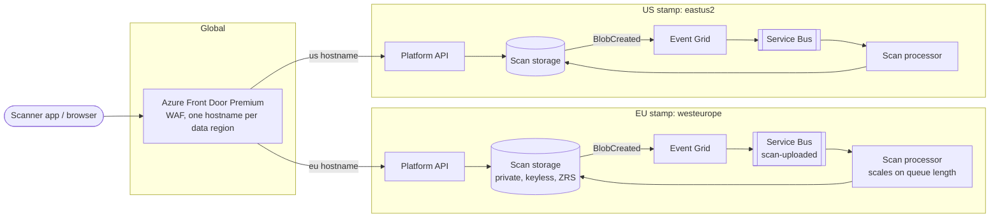

# Reality Capture Platform Blueprint

A reference Azure platform for a reality-capture SaaS: customers upload laser scans and 360° photos, the cloud processes them, and project teams view and share the results in the browser.

I built it to work through the problems such a platform faces once hardware moves to subscriptions and every scanner sold keeps sending data for years:

- **Scale without cost growing at the same rate.** Scan data is large, written once and read less every month.
- **Data residency.** EU customers' data stays in the EU, US customers' data in the US.
- **AI coding agents write infrastructure.** That is fast, but it needs guardrails that do not depend on a human catching everything in review.
- **Build capacity for R&D** that exists only while jobs run.

Everything here can be checked without an Azure subscription: `terraform validate`, Checkov, policy unit tests and a policy gate against a real plan of the platform run in CI.

**Live demo: [satrilabs.github.io/reality-capture-platform](https://satrilabs.github.io/reality-capture-platform/).** The policies below, compiled to WebAssembly, checking changes from an engineer or an AI agent in your browser. Pick a ready-made change or build your own.

## Architecture



**Region stamps** ([infra/modules/region-stamp](infra/modules/region-stamp)). Each data region gets an identical, independent stamp. Nothing customer-related is shared, so one region's outage or mistake cannot reach the other, and adding a region is one more module call. Storage is zone-redundant by default. Geo-redundancy doubles the bill for data that is rarely read again, so it is opted into per tier, with a reason the policy asks for; Azure's region pairs stay inside the EU and inside the US, so residency holds either way.

**Global edge** ([infra/modules/global-edge](infra/modules/global-edge)). Front Door is the only shared piece. Each data region has its own endpoint and origin group, and an origin group only lists origins from its own region, so a failover can never route EU traffic to the US.

**Event-driven processing.** An upload lands in `raw-scans/`, Event Grid turns it into a message on a Service Bus queue, and processors scale on queue length. A burst of uploads after a big site visit waits in the queue instead of failing. Messages that fail five times go to a dead-letter queue for a person to look at.

**Least privilege.** The processor identity can read and write blobs in its own stamp and receive from its own queue. Event Grid can only send to that one queue. Storage and Service Bus accept Entra ID only; account keys are switched off.

## Guardrails for AI-written infrastructure

The goal: application teams and AI coding agents deliver infrastructure quickly, safely and cost-effectively, without a platform engineer reading every line. The approach:

1. **Agents propose, pipelines apply.** An agent works on an `ai/<task>` branch and opens a pull request. It has no credentials that can change Azure.
2. **Every plan is checked by policy** ([policy/terraform](policy/terraform)), written in Rego and run with OPA against `terraform show -json`. The same rules apply to everyone; agents get extra ones.
3. **A human approves the apply**, and the pipeline refuses to apply if the plan changed after approval.

| Rule | Applies to | Why |
|---|---|---|
| Required tags: owner, cost-center, data-region | everyone | cost per team and customer, residency reporting |
| Location must match the data-region tag | everyone | EU data never lands in a US region |
| Storage: no public network, no anonymous blobs, no account keys, TLS 1.2 | everyone | scan data is customer data, sometimes court evidence |
| Build agent pools: Spot, autoscaling, scale to zero | everyone | build capacity costs nothing when idle |
| Geo-redundant storage needs a `replication-reason` tag (warning) | everyone | it doubles the storage bill |
| Cannot grant Owner, Contributor or access-admin roles | agents | an agent must not widen its own or anyone's access |
| Cannot delete or replace stateful resources | agents | a rename that forces a replace would destroy data |
| Cannot touch Azure Policy or diagnostic settings | agents | agents must not switch off the guardrails or the audit trail |
| At most 25 resource changes per plan | agents | large changes get split so a reviewer can follow them |
| Deleting stateful resources needs a second approver (warning) | humans | same risk, but a human may have a reason |

Try it:

```bash
opa test policy/ -v
scripts/policy-check.sh examples/plans/ai-safe-change.json ai-agent    # Allowed.
scripts/policy-check.sh examples/plans/ai-risky-change.json ai-agent   # Blocked, 7 reasons
scripts/policy-check.sh examples/plans/blueprint-prod.json human       # the real 57-resource plan: Allowed
scripts/policy-check.sh examples/plans/blueprint-prod.json ai-agent    # Blocked: too big, touches audit logging
```

The risky example is the kind of change an agent produces when asked to "add an export bucket for a customer": a new storage account in the wrong region with public access and keys, a broad Contributor grant to make it work, a rename that silently replaces the main scan store, and removal of the policy that was in the way. Each of those is caught, with a reason the agent can act on.

## Pipelines

[pipelines/infra.yml](pipelines/infra.yml) (Azure DevOps) is the only path to production:

- **Check:** formatting, `terraform validate`, Checkov, policy unit tests.
- **Plan:** a read-only federated identity (no secrets) runs the plan; the author type comes from the branch; the policy gate runs. The plan file contains secrets, so it is never published. Only a fingerprint of the changes and a readable summary are kept.
- **Apply:** a deployment job on an environment with an approval check. A separate write identity, usable only from that environment, re-plans and applies only if the fingerprint still matches what was approved.

[pipelines/drift.yml](pipelines/drift.yml) runs every night, plans against live Azure and fails with a list of drifted resources. It never fixes drift on its own, because the right fix may belong in the code.

## Build agents for R&D

Build capacity that exists only while jobs run, in a shared-responsibility model:

- **The platform owns** the node pool ([infra/modules/build-agents](infra/modules/build-agents)): Spot VMs, autoscaling from zero, ephemeral OS disks, host encryption, taints so only agent pods land there, and the cost ceiling (`max_nodes`). It also owns placement, identity, secrets, network rules and scaling ([platform/build-agents/base](platform/build-agents/base)).
- **Each team owns** its build image, pool name and resource size, in a small overlay ([platform/build-agents/teams/web](platform/build-agents/teams/web)). A new team copies that folder.

KEDA watches the Azure DevOps pool and starts one agent pod per waiting job; the pod runs that job and exits. KEDA reads the Azure DevOps token straight from Key Vault, the agent gets it as a read-only file, and both authenticate with workload identity, so no secret is in Git or stored as a Kubernetes secret. Agents can only reach DNS and outbound HTTPS. A Spot eviction fails the job, and Azure DevOps retries it on a fresh agent; release builds can use a small regular pool instead.

## Reliability and cost

- [docs/reliability.md](docs/reliability.md): SLOs for upload, processing and the viewer, the error budget policy, burn-rate alerts, telemetry and recovery.
- [docs/cost.md](docs/cost.md): what a terabyte of scans costs per tier and region (Azure list prices), what the tiering rule saves, and the levers ranked for this workload.

## Layout

```
infra/
  envs/prod/            two stamps and the edge, applied only by the pipeline
  modules/region-stamp/ storage, events, queue, identities, logs for one region
  modules/global-edge/  Front Door, WAF, per-region routing
  modules/build-agents/ Spot node pool and workload identity for pipeline agents
policy/terraform/       Rego rules and their unit tests
examples/plans/         plan JSON used to demonstrate the policy gate
platform/build-agents/  KEDA agents: platform base, one overlay per team
pipelines/              Azure DevOps: infra plan/apply, nightly drift
scripts/                policy-check.sh used by the pipelines, build-site.sh for the demo
site/                   the live demo page (published by .github/workflows/pages.yml)
docs/                   reliability and cost notes
```

## Next

- The scan processor itself, instrumented as described in docs/reliability.md
- An AKS cluster module for the agents' node pool to join
